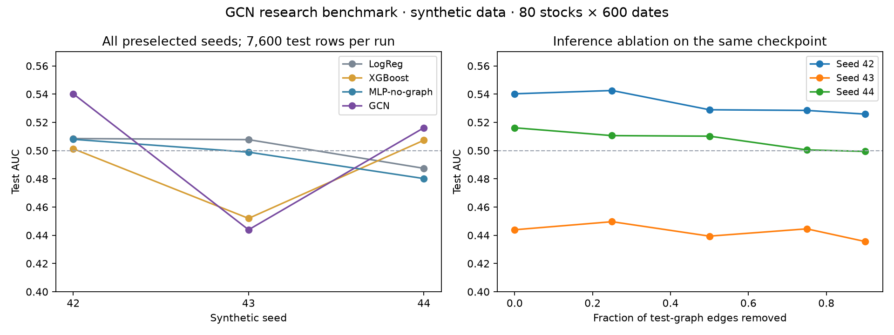

# Investor Network GCN — 投资者网络与图神经网络收益预测

> **独立研究项目 · 2026.08 至今 · 复杂网络 · 金融大数据**
>
> 使用合成 HS300 风格股票的历史收益相关性与模拟基金持仓构建股票网络，
> 比较 LR / XGBoost / 无图 MLP / GCN 的未来 20 日相对收益分类表现。
> 单次时间切分按标签期限隔离；报告所有预先选定种子与同一 checkpoint 的
> 测试图边移除实验。当前三种子结果没有显示稳定的 GCN 排序优势。

本仓库是该项目的**可复现工程实现**：合成数据、特征工程、图构建、四种
模型（LR / XGBoost / MLP / GCN）、消融实验、可视化与可下载的实验报告
一键生成。

---

## 1. 项目亮点

| 模块 | 实现 |
|---|---|
| 数据 | 合成 300 只 HS300 风格股票 × 1500 日 × 27 个申万行业；含基金持仓网络 |
| 节点特征 | 23 列：多窗口收益 / 波动率 / 动量 / 偏度 / 峰度 / 9 个财务因子 |
| 图构建 | **阈值图** / **k 近邻图** / **行业先验图** / **共同基金持仓图** / 并集 |
| 网络统计 | 已计算用于图诊断；当前 23 列模型输入不含网络统计量 |
| 基线 | Logistic Regression · XGBoost · 无图 MLP（BatchNorm + GELU + Dropout） |
| GNN | 自实现 GCN（2 层 + 边权重的 Kipf-Welling 归一化） |
| 评估 | AUC / Brier / ECE / Top-10 命中率 / 多空十等分收益 / 分行业 / 分市场阶段 |
| 已执行消融 | 特征组消融 · 同一 checkpoint 的测试图边 drop 曲线 |
| 工程 | 标签期限隔离；CPU / CUDA；逐行预测、checkpoint、配置与数据哈希；CI 快测 |

---

## 2. 仓库结构

```
investor-network-gnn/
├── README.md                 # 本文件
├── LICENSE                   # MIT
├── requirements.txt          # 依赖
├── pyproject.toml            # 项目元信息
├── configs/
│   └── config.yaml           # 所有超参与窗口长度
├── src/
│   ├── data/
│   │   ├── synthetic.py      # 因子模型 + 行业因子 + 厚尾残差 + 真实风格动量
│   │   ├── features.py       # 多窗口节点特征 + 标签（y_dir / y_risk / fwd_ret）
│   │   └── loader.py         # 加载 / 生成 / 缓存
│   ├── graphs/
│   │   ├── builders.py       # 阈值图 / kNN / 行业 / 基金持仓
│   │   ├── stats.py          # 中心性 / PageRank / 集聚 / 社区
│   │   └── snapshots.py      # 时序图快照 + 信息隔离
│   ├── models/
│   │   ├── baselines.py      # LR + XGBoost + MLP
│   │   └── gcn.py            # 轻量 GCN（含边权重）+ PyG 后端
│   ├── training/
│   │   ├── split.py          # 单次时间切分 + purge gap
│   │   ├── metrics.py        # AUC / Brier / ECE / 长短收益
│   │   ├── trainer.py        # 全流程编排
│   │   ├── ablation.py       # 特征 / 边 / 随机化 消融
│   │   └── plots.py          # 所有可视化
│   └── utils/common.py       # 配置 / 路径 / 随机种子 / OMP 调优
├── scripts/
│   └── run_pipeline.py       # 一键全流程入口
├── data/                     # 自动生成（已加入 .gitignore）
│   ├── raw/                  #   ├─ prices / returns / fundamentals / fund_holdings ...
│   └── processed/            #   └─ 中间 parquet
├── outputs/
│   ├── figures/              # 10 张实验图（PNG）
│   ├── reports/              # results.json / results.md / data_summary.json
│   └── models/               # 训练好的模型权重
├── notebooks/                # （可选）探索用
└── tests/                    # （可选）单元测试
```

---

## 3. 技术栈

* **Python 3.10+**
* **PyTorch 2.2+** — 轻量 GCN 主体（自实现 Kipf-Welling 归一化）
* **XGBoost 2.0+** — 树模型基线
* **scikit-learn 1.4+** — LR / 指标
* **NetworkX 3.3+** + **python-louvain** — 图分析 / 社区发现
* **pandas / numpy / scipy** — 数据栈
* **matplotlib / seaborn** — 可视化（已配置 CJK 字体）

> 设计原则：**没有一个组件是黑箱**。GCN 层只有 ~80 行；图构建器每个
> 不到 50 行；评估指标全部可单测。读者可以从 `src/models/gcn.py` 读起，
> 顺着 import 走完整个 pipeline。

---

## 4. 快速开始

```bash
# 1. 克隆 / 进入项目
cd investor-network-gnn

# 2. 准备 Python 环境（Python 3.10+）
python -m venv .venv
source .venv/bin/activate          # Windows: .venv\Scripts\activate
pip install "torch>=2.2,<3" --index-url https://download.pytorch.org/whl/cpu
pip install -r requirements-test.txt

# 3. 跑 quick 研究配置
python scripts/run_pipeline.py --quick

# 4. 默认 300 × 1500 规模（本轮未运行；全批 GCN 需要更多内存）
python scripts/run_pipeline.py
```

参数说明：

| Flag | 作用 |
|---|---|
| `--quick` | 把宇宙缩到 80 只股票、600 天，GCN 仅训 20 epoch；用来冒烟 |
| `--skip-gcn` | 只跑基线，**不**训练 / 评估 GCN |
| `--no-ablation` | 跳过所有消融（feature / edge-drop） |
| `--config PATH` | 替换配置文件路径 |

跑完后结果落在：

```
outputs/
├── figures/
│   ├── 01_corr_distribution.png       成对相关性分布 + 85 分位阈值
│   ├── 02_graph_snapshot.png          最近一周期的图可视化
│   ├── 03_roc_curves.png              四模型 ROC
│   ├── 04_calibration.png             可靠性图 (ECE)
│   ├── 05_metrics_bar.png             AUC / Brier / ECE / 长短收益 条形
│   ├── 06_per_industry_auc.png       27 个行业 × 4 模型 AUC
│   ├── 07_per_regime_auc.png          牛 / 熊 / 震荡市 AUC
│   ├── 08_gcn_long_short.png          逐日期前瞻期多空收益差（非净值）
│   ├── 09_edge_drop_curve.png         边 drop 比例 vs AUC
│   └── 10_xgb_feature_importance.png  XGBoost Top-20 重要性
└── reports/
    ├── results.md                     实验报告（Markdown）
    ├── results.json                   完整 JSON
    └── data_summary.json              数据 / 切分摘要
```

---

## 5. 方法论

### 5.1 数据

为了避免读者被 Tushare / Wind 账号挡住，我们 **默认用合成数据**：
300 只股票 × 1500 个交易日，按 27 个申万行业分布；用 *市场 + 规模 +
价值 + 动量 + 低波* 五因子 + 行业因子 + GARCH 类波动率聚类 + 学生 t
厚尾残差生成；并模拟 100 只共同基金（偏好大盘 / 同行业集中持仓）。

如果你想换真实数据，把以下六个 parquet 文件丢进 `data/raw/` 即可：

| 文件 | schema |
|---|---|
| `prices.parquet` | 行=date, 列=stock_id |
| `returns.parquet` | 行=date, 列=stock_id（简单收益率） |
| `fundamentals.parquet` | 行=stock_id, 列=log_market_cap, beta, roe, ... |
| `fund_holdings.parquet` | 列：fund_id, stock_id, weight |
| `stock_industry.parquet` | 行=stock_id, 列=industry |
| `market_regime.parquet` | 行=date, 列=regime（bull / bear / sideways） |

下次启动时 `loader.py` 会直接读 cache 而不重新生成。

### 5.2 节点特征（23 列）

- **多窗口收益 / 动量**：5d / 20d / 60d / 120d / 250d 的累计收益、滚动均值
- **波动率**：20d / 60d 滚动标准差、5d / 20d 绝对收益均值
- **分布**：20d 偏度 / 峰度
- **基本面**：log 市值、β、ROE、资产增长、杠杆、PE、PB、EP、换手率

标签：未来 20 日收益的横截面中位数 → `y_dir ∈ {0, 1}`；
未来 20 日波动率三分位 → `y_risk ∈ {0, 1, 2}`。

### 5.3 图构建

| 图 | 构造方式 | 用途 |
|---|---|---|
| 阈值图 | 滚动 60d 相关性矩阵 \|ρ\| ≥ 85 分位的无向边 | 捕捉共同波动 |
| k 近邻图 | 每只股票取相关系数 top-k 邻居 | 局部关联 |
| 行业先验图 | 同一申万行业两两相连 | 行业聚集的 baseline |
| 基金持仓图 | 共持 ≥ 85 分位的股票相连 | 投资者网络 |
| **并集** | 上述 4 种的边并集，权重取均值 | **GCN 的输入** |

每 20 个交易日重建一次图（graph signal 在金融时间尺度上变化缓慢），
并使用 `select_graph_dates` 在没有快照的日期上 forward-fill。

### 5.4 模型

- **Logistic Regression** — `L2, C=1`, `lbfgs`；纯线性 baseline
- **XGBoost** — 400 trees, depth=5, lr=0.05；非线性树 baseline
- **MLP-no-graph** — `[128, 64]` 隐层 + BN + GELU + Dropout 0.3；**无图结构**
- **GCN** — 2 层 GCN (`[64, 32]`) + BN + GELU + Dropout 0.4；
  边权重进入 `D^{-1/2}(A + I)D^{-1/2}` 的归一化；
  支持 `add_self_loops` + 节点度数对称化。

> **MLP-no-graph vs GCN** 是模型比较，但当前两者的隐藏层宽度、Dropout
> 和训练配置不同，性能差异不能全部归因于图结构。识别图结构的增量价值还需
> 匹配模型容量与训练预算，并结合一致评估口径下的边消融和图随机化实验。

### 5.5 训练与评估

- **时间切分**：单次按日期划分 60% train / 15% val / 25% test；比例指
  隔离前的分区，随后从验证集和测试集开头各移除默认 20 个交易日期。
  切分器接收标签期限，要求 `purge_gap >= label_horizon`，并检查隔离后各分区
  仍有足够样本。旧版本使用未来 20 日标签却仅隔离 5 日，边界标签窗口会重叠。
  该边界问题已修复并加入回归测试；下方三种子 quick 已按新切分完整重算。
- **优化**：AdamW + cosine schedule，MLP 训 80 epoch、GCN 训 120 epoch
  带早停（patience 15）。
- **指标**：
  - AUC（方向预测）
  - Brier score + ECE（概率校准）
  - Top-10% 正收益比例：预测排名前 10% 股票中，未来 20 日收益为正的比例；它不等同于 `y_dir` 分类精度，也没有固定 0.5 随机基准
  - 逐信号日前瞻 20 日多空收益差（long top decile, short bottom decile）；窗口相互重叠，不能逐日复利解释为组合净值
  - 分行业 / 分市场阶段切片

### 5.6 消融研究

1. **特征组消融**：剔除收益-波动率组 / 基本面 / 动量；当前 `no_network_stat` 与完整输入均为 23 列，是保留的空消融，不能证明网络特征没有作用
2. **边 drop 曲线**：复用主比较中经验证集选择的同一 GCN checkpoint，仅移除测试图的 0% / 25% / 50% / 75% / 90% 边；不重新训练，0% 行必须复现主比较 AUC
3. **图随机化（待接入实验）**：`randomize_graph` 工具函数已实现，但默认 pipeline 未调用；本轮未运行，不纳入实证结论
4. **市场阶段漂移**：在 bull / bear / sideways 三段分别评估

---

## 6. 三种子复现实验（2026-09-17）

完整执行 `--quick`（80 只股票 × 600 日，GCN 20 epochs、MLP 10 epochs），
预先固定种子 42、43、44，均含四模型、特征消融和同一 checkpoint 的测试图边移除。
每次测试集为 95 个信号日、7,600 行。下表展示全部运行，未选择性保留种子。

| Model | Seed 42 AUC | Seed 43 AUC | Seed 44 AUC | 均值 ± 样本标准差 |
|---|---:|---:|---:|---:|
| LogReg | 0.5085 | 0.5078 | 0.4874 | 0.5012 ± 0.0120 |
| XGBoost | 0.5013 | 0.4520 | 0.5073 | 0.4869 ± 0.0304 |
| MLP-no-graph | 0.5080 | 0.4989 | 0.4802 | 0.4957 ± 0.0142 |
| GCN | 0.5402 | 0.4439 | 0.5162 | 0.5001 ± 0.0501 |

GCN 相对 MLP 的 AUC 差为 `+0.0322 / −0.0550 / +0.0360`，均值 `+0.0044`。
GCN 平均 AUC 约 0.5001，跨种子波动明显，**当前证据不支持稳定的图模型排序优势**。
三个种子不足以给出显著性结论；模型容量和训练预算也未匹配。



- [实验说明与复现命令](experiments/2026-09-17/README.md)
- [全部指标 CSV](experiments/2026-09-17/metrics.csv) · [机器可读汇总 JSON](experiments/2026-09-17/summary.json)
- 已从保存的逐行预测独立复算 60 个指标，全部误差不超过 `1e-12`；三次 0% 边移除 AUC 均与主比较完全一致。
- 旧版结果单独保留为[历史记录](outputs/reports/historical-pre-fix.md)，不能用于解释修复后的表现。

当前均为合成数据，真实 A 股和默认 300 × 1500 规模尚未验证。真实数据还需核验
历史成分股、财务和基金持仓披露日期；静态模拟持仓不能代表真实历史可得性。

---

## 7. 常见问题

**Q: 我可以换成 PyG 的 GCNConv 吗？**
A: 可以。`src/models/gcn.py` 里已经留了 `PyGGCNClassifier`（需要
`pip install torch-geometric`）；该可选后端尚未做本轮等价性验证，需要单独核对归一化、自环和预测。

**Q: 跑得很慢怎么办？**
A: 改 `configs/config.yaml`：
- 把 `n_stocks` / `n_days` 调小（默认 300 / 1500）
- 把 `gcn.epochs` 调小（默认 120）
- 把 `graph.threshold.quantiles` 和 `knn.k_values` 都保留 1 个
- 或者直接用 `--quick`

**Q: macOS 上 XGBoost 报 `OMP: Error #179: pthread_mutex_init`？**
A: `src/utils/common.py` 已经在启动时设置 `OMP_NUM_THREADS=1`，
  `OPENBLAS_NUM_THREADS=1` 等。如果还遇到，重启 shell 即可。

**Q: 中文图例显示为方块？**
A: `src/training/plots.py` 的 `_set_cjk_font()` 会按平台自动选
  `Hiragino Sans GB` / `STHeiti` / `Noto Sans CJK`。
  Linux 用户需要 `apt install fonts-noto-cjk`。

---

## 8. 后续扩展（Roadmap）

- [ ] 在匹配容量与训练预算后，扩展种子和市场时间窗口
- [ ] 接入并实跑度序列保持的图随机化对照
- [ ] 接入 Tushare / AkShare 一键拉真实数据
- [ ] 用 GraphSAGE / GAT 替换 GCN（处理不同邻居重要性）
- [ ] 加入 temporal GNN（TGN / DyRep）捕捉图动态
- [ ] 把训练报告自动 push 到 MLflow / Weights & Biases
- [ ] 接入聚宽 / 米筐做 paper trading 验证

---

## 9. License

MIT — 见 [LICENSE](LICENSE)。
