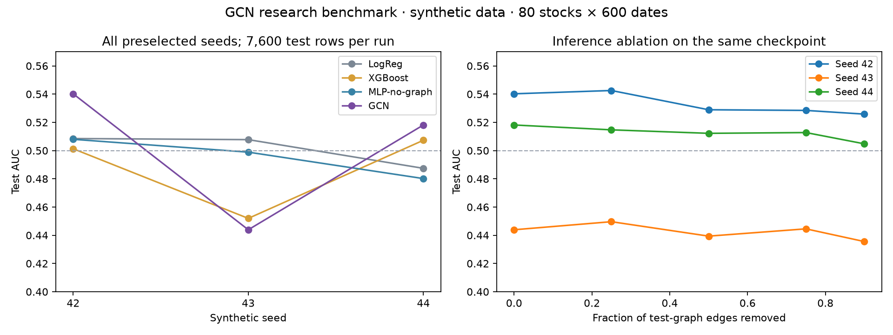

# Three-seed synthetic benchmark · 2026-09-28

在修复图节点顺序和等权边归零问题后，完整重跑固定的 42、43、44 三个种子；没有按结果筛选种子。GCN 平均 AUC 为 **0.5008**，相对 MLP 的平均差为 **+0.0051**，跨种子差异明显，不能据此认定图结构带来稳定预测增益。[修复前结果](../2026-09-17/README.md)保留供追溯。



## 实验协议

- 数据：每次重新生成 80 只合成股票 × 600 个交易日。原始数据哈希互不相同；均不是真实 A 股数据。
- 模型：Logistic Regression、XGBoost 400 trees、MLP 10 epochs、GCN 最多 20 epochs。其余参数见各次 `results.json` 的完整 `config`。
- 切分：60% / 15% / 25% 单次时间切分，验证集和测试集开头分别排除 20 个交易日期，覆盖未来 20 日标签期限。各次训练 21,840 行、验证 3,840 行、测试 7,600 行（95 个测试信号日）。
- GCN checkpoint 按验证集损失选择；测试标签不参与训练或早停。同一 checkpoint 用于主评估和全部测试图边移除，0% drop 不重新训练。
- 已执行：四模型比较、特征组消融、0% / 25% / 50% / 75% / 90% 测试图边移除，以及行业/市场状态切片。
- 未执行：度序列保持的图随机化、真实市场验证、默认 300 × 1500 规模。网络统计量未进入当前 23 列特征，`no_network_stat` 是空消融。

## 所有种子的 AUC

| Model | Seed 42 | Seed 43 | Seed 44 | 均值 ± 样本标准差 |
|---|---:|---:|---:|---:|
| LogReg | 0.5085 | 0.5078 | 0.4874 | 0.5012 ± 0.0120 |
| XGBoost | 0.5013 | 0.4520 | 0.5073 | 0.4869 ± 0.0304 |
| MLP-no-graph | 0.5080 | 0.4989 | 0.4802 | 0.4957 ± 0.0142 |
| GCN | 0.5402 | 0.4439 | 0.5181 | 0.5008 ± 0.0505 |

GCN − MLP 分别为 `+0.0322 / −0.0550 / +0.0380`。三次 0% drop AUC 与主 GCN AUC 完全相同。种子 43 的 GCN 低于随机排序水平；不能用另两个种子的正差替代这一结果。

标准差描述这三个合成实验的变化，不是标准误或置信区间。模型容量、输入标准化和训练预算没有匹配，GCN 与 MLP 的差异不能全部归于图结构。

## 指标定义

- AUC / Brier / ECE 使用 `y_dir`：未来 20 日收益是否高于当天股票横截面中位数。
- `top_hit` 是预测分数前 10% 股票中未来 20 日收益为正的比例；它不等于相对收益标签精度，也没有固定 0.5 随机基准。
- `long_short` 是各信号日的前瞻 20 日 top-minus-bottom decile 收益差的均值。窗口重叠，未计交易成本、容量和卖空约束，不能当作可交易日收益或逐日复利净值。

## 可核验产物

- [全部逐种子指标 CSV](metrics.csv) · [汇总 JSON](summary.json) · [独立复核脚本](summarize.py)
- 每个 `seed-{42,43,44}/outputs/reports/` 内含完整 `results.json`、切分与特征表 `data_summary.json`、逐行预测 `test_predictions.parquet` 和报告 `results.md`。
- 每个 `seed-*/outputs/models/gcn.pt` 保存实际评估的 state dict，SHA-256 写入结果；`outputs/figures/` 保存该次完整图表。
- JSON 记录完整配置、Python 和主要库版本、输入数据哈希、源码内容哈希与训练源码提交 `98081009cb36df12171111043ed5649ff1cf2e84`。

`summarize.py` 不调用内部指标函数。它从逐行预测独立复算 3 × 4 × 5 = **60 个指标**，全部与原报告误差不超过 `1e-12`，并核验 checkpoint 哈希、三个不同数据哈希和 0% drop 一致性。未定义的指标在 JSON 中为标准 `null`。

## 复现

从仓库根目录执行；使用独立输出目录，避免不同种子共用旧数据缓存：

```bash
export OMP_NUM_THREADS=1 OPENBLAS_NUM_THREADS=1 MKL_NUM_THREADS=1
for seed in 42 43 44; do
  python scripts/run_pipeline.py --quick --seed "$seed" --force-data \
    --run-dir "experiments/2026-09-28/seed-$seed"
done
python experiments/2026-09-28/summarize.py
python -m pytest tests/ -q
```

本次在 Python 3.12.13、CPU PyTorch 2.14.0 环境执行，包版本详见 JSON。数值可能随底层库和硬件变化；本次没有跨环境位级一致性验证。默认规模未在这台 8 GB 内存机器上运行。
